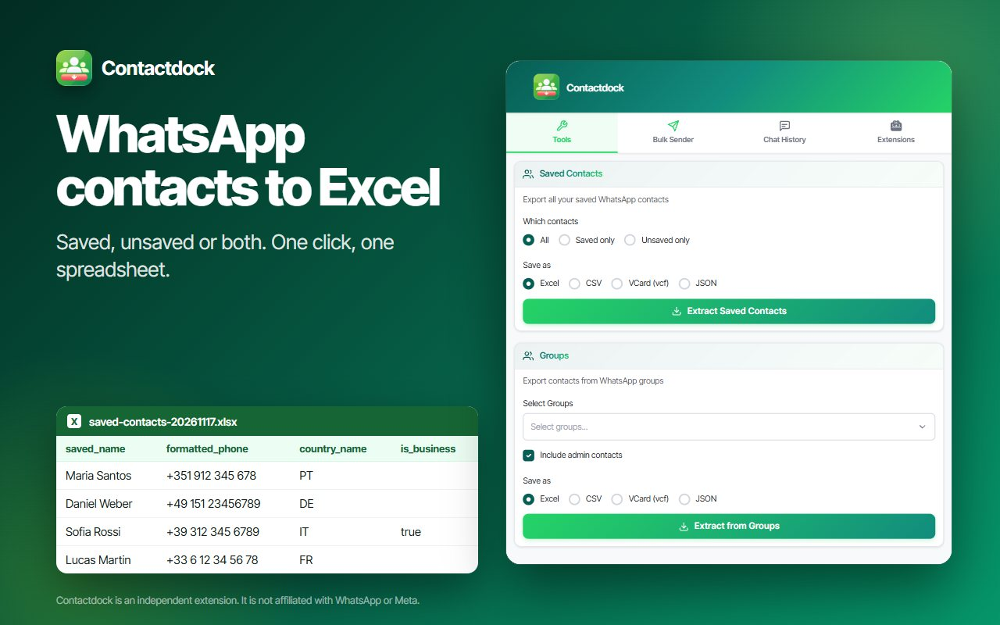
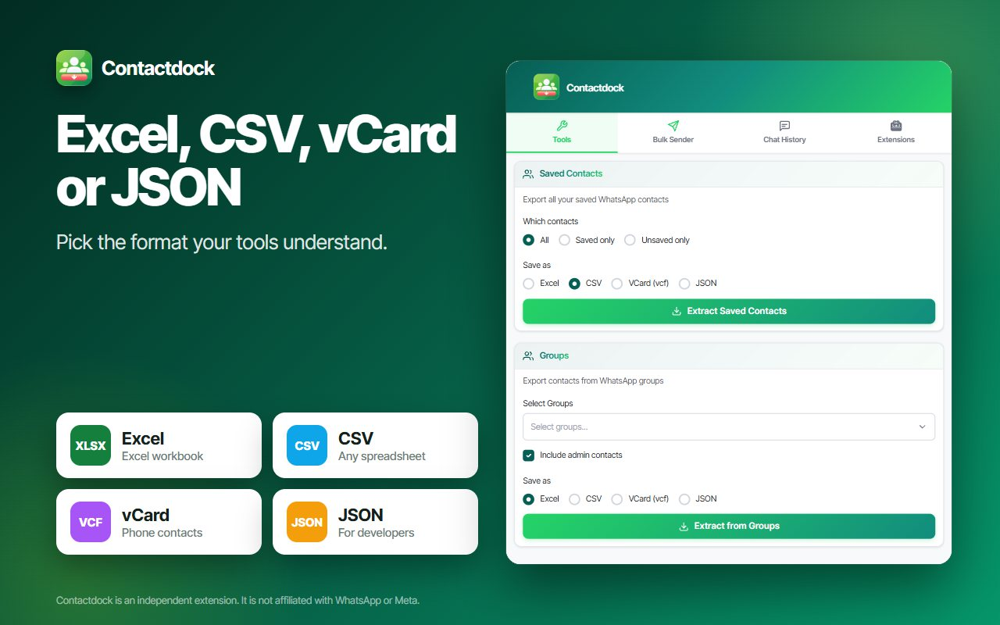

# Contactdock - WhatsApp Contacts Extractor (Export WhatsApp Contacts and Group Members)

Contactdock is a Chrome extension for WhatsApp Web that exports your WhatsApp contacts, chat contacts and group members to Excel (.xlsx), CSV or vCard (.vcf). Open the group or chat on web.whatsapp.com, click the Contactdock icon and save the list as a file. It runs inside your browser, with no account and no third-party server.

<a href="https://chromewebstore.google.com/detail/cmbnmnfclolmdoienholojjecenpofhk?utm_source=github&utm_medium=readme&utm_campaign=contactdock">Chrome Web Store</a> |
<a href="https://www.addonschrome.com/extensions/contactdock-whatsapp-contacts-extractor.html?utm_source=github&utm_medium=readme&utm_campaign=contactdock">Full guide and FAQ</a> |
<a href="https://www.youtube.com/watch?v=vAf2J5yN_Hk">Video demo</a>

This repository is the public home for Contactdock's documentation, release notes and issue tracker. The extension itself is distributed through the Chrome Web Store.

> **Name change:** this extension was previously listed as "WASendly Contacts Extractor". It is now called **Contactdock**. Same extension, same Chrome Web Store listing, new name.

## What it exports

- **WhatsApp contacts:** the contacts from your chats, saved, unsaved or both.
- **WhatsApp group members:** pick a group you belong to and export its participant list, including the numbers of members you never saved, as WhatsApp Web shows them in the group.
- **Phone numbers in international format,** ready for a spreadsheet, CRM or address book.
- **Formats:** Excel (.xlsx), CSV (.csv) and vCard (.vcf).

## How to export WhatsApp contacts to Excel, CSV or vCard

1. Add Contactdock to Chrome from the Chrome Web Store.
2. Open WhatsApp Web (web.whatsapp.com) and let your chats load.
3. Click the Contactdock icon in the toolbar.
4. Choose contacts or a group, pick the format and click export. The file downloads to your computer.

## How to extract WhatsApp group contacts

1. Open the group on WhatsApp Web.
2. Click the Contactdock icon.
3. Export the group member list to Excel, CSV or vCard.

The extension only collects what WhatsApp Web already shows you. It cannot reveal hidden numbers, read private chats or reach anyone outside the groups you have joined.

## Privacy

- Runs locally in your browser on WhatsApp Web; no account is needed.
- No QR re-scan and no third-party server: your contacts go straight into the file you download.
- No official WhatsApp API is involved.

## Use exported numbers responsibly

A contact or group export is a list of other people's personal data. Export for your own records, your CRM or to re-contact people who already know you. Collecting numbers from a group does not give you permission to message them in bulk: unsolicited messages get WhatsApp numbers banned and in many countries break data-protection law (GDPR, KVKK, CAN-SPAM).

## Screenshots

## Support

Found a bug or have a request? [Open an issue](../../issues).

## Disclaimer

Contactdock is an independent extension. It is not affiliated with, endorsed by or sponsored by WhatsApp or Meta Platforms, Inc. WhatsApp is a trademark of its owner.

---

Built and maintained by [Addons Chrome](https://www.addonschrome.com/?utm_source=github&utm_medium=readme&utm_campaign=contactdock).
